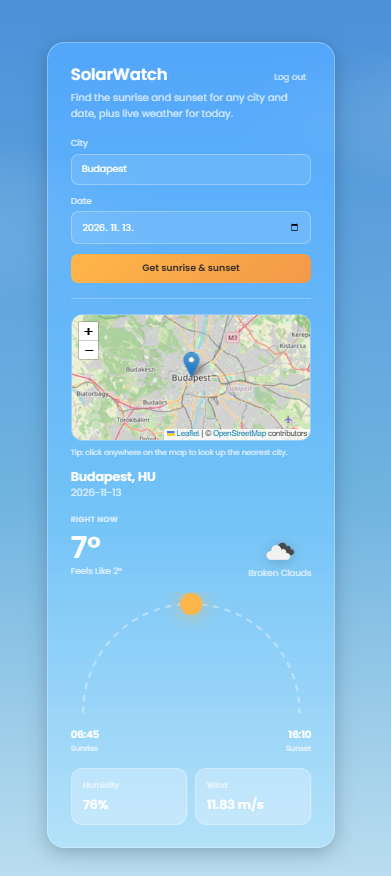

# SolarWatch 

Find the sunrise and sunset for any city and date, plus live weather for today. Search by city name or simply click on the map.

**Live demo:** https://solar-watch.pages.dev

> The backend runs on a free hosting tier and goes to sleep after 15 minutes of inactivity. The first request can take up to 1–2 minutes while it wakes up (the app shows a hint while you wait).



## Features

- **Sunrise & sunset times** for any city and date, shown in the **city's local time** on a sun-arc visualization (UTC values are returned as well)
- **Live weather** (temperature, feels-like, humidity, wind) for today, fetched from OpenWeather and deliberately not cached, since it changes constantly
- **Interactive map** (Leaflet + OpenStreetMap): the searched city is marked on the map, and clicking anywhere finds the nearest city through reverse geocoding
- **JWT authentication**: registration and login, with proper `401` and `409` responses, and an automatic redirect to the login page when the token expires
- **Cache-aside caching**: cities and sunrise/sunset times are stored in PostgreSQL, so repeated searches skip the external APIs
- **Centralized error handling** with a global exception handler (for example `404` when no city is found near a clicked point)
- **Responsive "glass sky" UI** with a day/night theme, built with plain CSS

## Tech stack

| Layer | Technology |
|---|---|
| Backend | Java 25, Spring Boot 3.5, Spring Security (JWT), Spring Data JPA, WebClient |
| Database | PostgreSQL (Neon in production, H2 in tests) |
| Frontend | React 19, Vite, React Router, react-leaflet, plain CSS |
| External APIs | OpenWeather (geocoding, reverse geocoding, current weather), Sunrise-Sunset API |
| Testing | JUnit 5, Mockito, MockMvc, MockWebServer (integration tests) |
| CI/CD | GitHub Actions, Docker / Docker Compose |
| Hosting | Render (backend), Neon (database), Cloudflare Pages (frontend) |

## How it works

1. The frontend sends the city name (or the clicked map coordinates) to the backend, with the JWT in the `Authorization` header.
2. For a city name, the backend looks in the database first and only calls the OpenWeather geocoding API on a miss. For coordinates, it calls the reverse geocoding API to find the nearest city, then saves it if it is new.
3. The backend gets the sunrise/sunset times (cached per city and date) and the live weather. It converts the times to the city's local time using the UTC offset reported by OpenWeather, and returns a single JSON response that also contains the coordinates.
4. The frontend stores the response in React state and passes the coordinates to the map component. Clicks on the map flow back to the page through a callback and start a new search.

## API

| Method | Endpoint | Description |
|---|---|---|
| POST | `/api/auth/register` | Register a new user (`409` if the username is taken) |
| POST | `/api/auth/login` | Log in and receive a JWT (`401` on bad credentials) |
| GET | `/api/solarwatch?city=&date=` | Sunrise, sunset and weather for a city |
| GET | `/api/solarwatch/by-coordinates?lat=&lon=&date=` | Same, for the nearest city to a point |

All `/api/solarwatch` endpoints require a valid JWT.

## Running locally

**Prerequisites:** Java 25, Node 22, Docker, and your own [OpenWeather API key](https://openweathermap.org/api) (the free plan is enough).

```bash
# 1. Set the environment variables (see the table below)

# 2. Start the database and the backend
[docker compose command]

# 3. Start the frontend
cd frontend
npm install
npm run dev
```

The frontend runs at http://localhost:5173 and the backend at http://localhost:8080.

### Environment variables

**Never commit real keys or passwords.** Set these in your environment or in a local `.env` file that is listed in `.gitignore`.

| Variable | Purpose |
|---|---|
| `OPENWEATHER_API_KEY` | Your own OpenWeather API key |
| `JWT_SECRET` | Secret used to sign JWTs (use a long random value) |
| `SPRING_DATASOURCE_URL` | JDBC URL of the PostgreSQL database |
| `DB_USERNAME`, `DB_PASSWORD` | Database credentials |
| `CORS_ALLOWED_ORIGINS` | Allowed frontend origins, e.g. `http://localhost:5173` |
| `VITE_API_URL` | Backend URL used by the frontend (defaults to `http://localhost:8080`) |

## Tests

```bash
mvn test
```

The suite covers the controllers (`@WebMvcTest`) and full integration flows against a mocked external API: registration, cache hit and cache miss. The tests run on every push through GitHub Actions.

## Deployment

- **Backend:** Docker image deployed on Render, configured through environment variables
- **Database:** managed PostgreSQL on Neon
- **Frontend:** built with Vite and hosted on Cloudflare Pages, deployed automatically from GitHub

## Known limitations

- Local times use the city's *current* UTC offset, so for dates in a different daylight-saving period they can be off by an hour.
- Reverse geocoding returns the nearest named place, which can be a district or a small village rather than a major city, and it is not cached.
- The free-tier backend needs a cold start after a period of inactivity.

## About this project and its git history

SolarWatch started as my solo project during the [Codecool full-stack program] in **[July 2026 – October 2026]**. I developed it locally without version control at first, and the project was only moved into a Git repository afterwards. Because of this:

- the commit history is **reconstructed**, not a record of the original development process
- there are **no separate feature branches**, because the features were not developed on branches

After finishing the course I kept improving it so it could stand as a real portfolio project. The later additions (live weather, redesign, deployment, error handling, interactive map, local-time conversion) were made in **[November 2026]**.


## Roadmap

- [ ] Nearby cities search with PostGIS (`ST_DWithin`)
- [ ] Exact time zone identifiers from coordinates for date-accurate local times
- [ ] AI-written daylight briefing with the Gemini API
- [ ] Integration tests against a real PostgreSQL database with Testcontainers

## Author

Built by Kíra Khern ([@kira-khern](https://github.com/kira-khern)).
